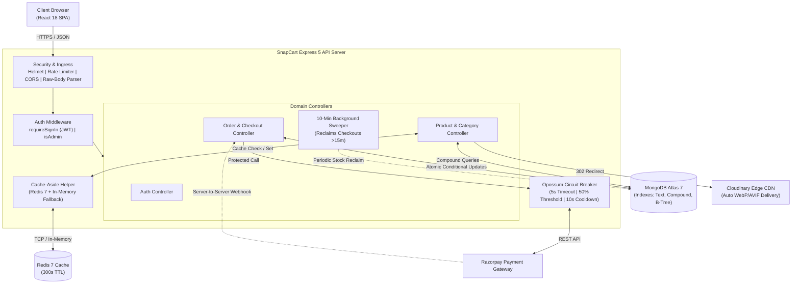
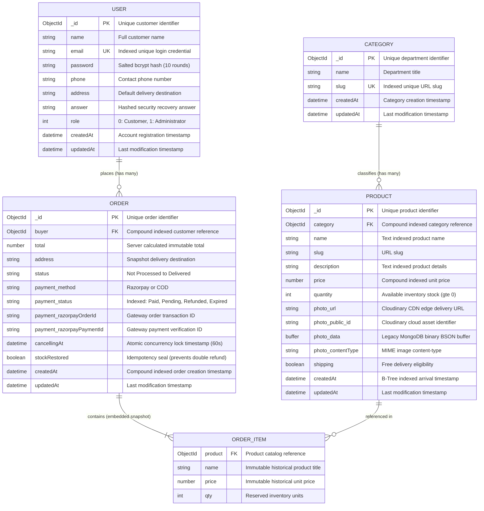
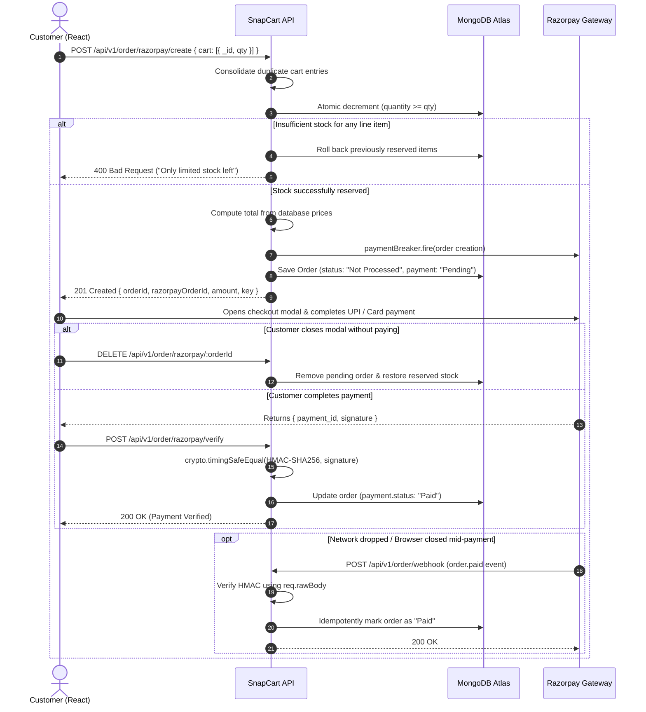

# SnapCart — Curated Luxury Marketplace

[](https://github.com/akshit-max/SnapCart-Ecommerce-APP/actions/workflows/ci.yml)


SnapCart is an enterprise-grade full-stack e-commerce web application built on the MERN stack (MongoDB, Express 5, React 18, Node.js). Engineered as a resilient Modular Monolith, SnapCart powers an end-to-end luxury shopping workflow featuring atomic inventory reservation, fault-tolerant payment processing with Opossum circuit breakers, Cloudinary edge CDN asset delivery, Redis cache-aside acceleration, cryptographic webhook reconciliation, and automated payment refunds upon cancellation.

The application is built to withstand high-concurrency race conditions, third-party payment gateway outages, and data desynchronization during checkout sessions without negative inventory or double stock restoration.

---

## Table of Contents

- [Overview](#overview)
- [Key Features](#key-features)
- [Screenshots & UI Walkthrough](#screenshots--ui-walkthrough)
- [Tech Stack](#tech-stack)
- [System Architecture](#system-architecture)
- [Database Design & Indexing Strategy](#database-design--indexing-strategy)
- [Engineering Decisions & Trade-offs](#engineering-decisions--trade-offs)
- [Performance & Benchmarks](#performance--benchmarks)
- [Frontend Engineering & Luxury UX Polish](#frontend-engineering--luxury-ux-polish)
- [Checkout & Payment Workflow](#checkout--payment-workflow)
- [Project Structure](#project-structure)
- [Installation & Getting Started](#installation--getting-started)
- [Environment Variables](#environment-variables)
- [Testing & Quality Assurance](#testing--quality-assurance)
- [Docker Deployment](#docker-deployment)
- [Production Build](#production-build)
- [API Reference](#api-reference)
- [Security Considerations](#security-considerations)
- [Known Limitations](#known-limitations)
- [Future Improvements](#future-improvements)
- [Author & License](#author--license)

---

## Overview

In production e-commerce architectures, critical systemic failures typically stem from concurrency races and external dependencies:

1. **Overselling Race Conditions**: Multiple buyers competing for limited stock simultaneously, resulting in negative inventory and broken order fulfillment.
2. **Third-Party Payment Outages**: Slow or failing payment gateways exhausting server socket pools and hanging the Node.js event loop.
3. **Abandoned Checkout Sessions**: Buyers closing browser tabs or abandoning payment modals mid-transaction, permanently stranding reserved inventory.
4. **Data Desynchronization**: Payment confirmation failures when client-side redirects fail, drop connection, or are intercepted.
5. **Database Asset Bloat**: Storing binary images directly as MongoDB BSON buffers, saturating WiredTiger RAM caches and degrading query throughput.

SnapCart resolves these challenges within a maintainable Modular Monolith using database-level atomic operations, circuit breaker fault-tolerance, Cloudinary CDN offloading, Redis cache-aside with in-memory fallbacks, and server-to-server webhook reconciliation.

---

## Key Features

### Customer Experience & Storefront
- **10 Curated Luxury Departments**: Discover apparel, luxury timepieces, footwear, designer sunglasses, fine fragrances, travel luggage, and consumer electronics.
- **Dynamic Multi-Parameter Discovery**: Real-time filtering by category multi-select, interactive price range sliders, arrival date sorting, and server-side pagination (6 items per page).
- **Full-Text Tokenized Search**: MongoDB text indexes with automated regex fallback for partial-word matching and input character escaping.
- **Cart & Promotional Engine**: Persistent client-side cart state with quantity adjustments and coupon engine supporting discount vouchers (`SNAPCART20` for 20% off, `WELCOME10` for 10% off).
- **Flexible Checkout Modes**: Dual checkout workflows—online payments via Razorpay (UPI, Credit/Debit Cards, Netbanking) and Cash on Delivery (COD).
- **Self-Service Cancellation & Automated Refunds**: Track order states (`Not Processed` &rarr; `Processing` &rarr; `Shipped` &rarr; `Delivered`). Customers can cancel unfulfilled orders, immediately restoring inventory and triggering automated Razorpay refunds.
- **Profile & Security Governance**: Customer address management and security-question-based password reset with salted hashes.

### Administrative Governance
- **Executive Metrics Dashboard**: Real-time overview of gross revenue, aggregate orders, catalog count, customer directory, and automated low-stock warnings ($\le 5$ units).
- **Product Lifecycle Management**: Complete CRUD interface supporting multipart Cloudinary image uploads, instant image previews, and category associations.
- **Category Governance**: Department creation and slug generation, with safety locks blocking deletion of categories containing active products.
- **Order Fulfillment Controls**: State progression controls (`Processing`, `Shipped`, `Delivered`, `Cancelled`) with automated inventory restocking and payment refunds on administrative cancellation.

### Reliability & System Design
- **Atomic Stock Reservation**: Single-query conditional decrements (`$gte`) eliminating overselling under concurrent checkout spikes.
- **Opossum Payment Circuit Breaker**: Wraps payment gateway calls with a 5-second timeout, 50% error threshold, and 10-second recovery cooldown, gracefully failing over to Cash on Delivery.
- **Automated Inventory Sweeper**: Background sweeper runs every 10 minutes to release stranded stock from abandoned checkouts ($>15$ minutes) without deleting financial audit logs.
- **Resilient Redis Cache-Aside**: Read-heavy catalog queries are cached in Redis for 300 seconds with write-through invalidation on mutations and a zero-crash in-memory fallback.
- **Raw-Byte Webhook Reconciliation**: Asynchronous server-to-server Razorpay webhooks validate HMAC-SHA256 signatures against raw request buffers using timing-safe comparisons.

---

## Screenshots & UI Walkthrough

> *Note: Place application screenshots in `docs/screenshots/` prior to public presentation.*

| View | Description | Screenshot Location |
| :--- | :--- | :--- |
| **Luxury Storefront & Hero Carousel** | Interactive carousel, category visual row, promotional deal ribbon, and curated product grid. | `docs/screenshots/storefront.png` |
| **Product Details & Sticky Bag** | Dynamic customer ratings, MRP discount tags, delivery estimation, and single-toast cart additions. | `docs/screenshots/product-details.png` |
| **In-App ConfirmModal** | Glassmorphic confirmation modal replacing native browser popups for cancellations and deletions. | `docs/screenshots/confirm-modal.png` |
| **Cart & Promo Coupon Engine** | Real-time price breakdown, voucher application (`SNAPCART20`), and dual checkout modal. | `docs/screenshots/cart-checkout.png` |
| **Admin Executive Dashboard** | Real-time revenue metrics, inventory health, low-stock warnings, and order status fulfillment. | `docs/screenshots/admin-dashboard.png` |

---

## Tech Stack

| Domain | Technology | Exact Version | Purpose & Architectural Justification |
| :--- | :--- | :--- | :--- |
| **Frontend** | React | `^18.2.0` | Component-based Single Page Application with Concurrent Mode features |
| | React Router DOM | `^7.7.0` | Client-side routing with nested layouts and private route guards |
| | Context API | Built-in | Global state management for authentication, cart, and search |
| | Axios | `^1.10.0` | HTTP client with automatic JWT authorization header injection |
| | Bootstrap & Ant Design | `^5.3` / `^6.3` | Responsive layout grid, form controls, and UI primitives |
| | React Hot Toast | `^2.5.2` | Single-authority glassmorphic notification toasts with deduplication IDs |
| | React Icons | `^5.5.0` | Lightweight Feather and FontAwesome icon set |
| **Backend** | Node.js | `>=20.x` | High-throughput asynchronous runtime (ES Modules) |
| | Express | `^5.1.0` | RESTful API server framework with native async error handling |
| | Mongoose | `^8.16.4` | MongoDB Object Data Modeling with compound, text, and status indexes |
| | Opossum | `^10.0.0` | Circuit Breaker pattern preventing cascade failure on payment gateway delays |
| | JSON Web Tokens | `^9.0.2` | Stateless authentication tokens with 7-day expiration |
| | bcrypt | `^6.0.0` | Salted hashing for passwords and security recovery answers (10 rounds) |
| | express-rate-limit | `^8.7.1` | Ingress brute-force protection (20 requests per 15-minute window) |
| | helmet | `^8.3.0` | HTTP security headers and protocol hardening |
| | Nodemailer | `^7.0.5` | SMTP transport for customer contact inquiries with HTML sanitization |
| **Database** | MongoDB Atlas / Local | `7.x` | Primary document database supporting atomic document write locks |
| **Media & CDN** | Cloudinary SDK | `^2.11.0` | Cloud object storage, automatic WebP/AVIF format optimization, and edge CDN delivery |
| **Caching** | Redis / ioredis | `^6.0.0` | Cache-aside catalog storage with 300s TTL and in-memory Map fallback |
| **Payments** | Razorpay Node SDK | `^2.9.8` | Order generation, HMAC validation, and automated refunds |
| **Testing** | Node.js Test Runner | `node:test` | Zero-dependency native test runner executing 30 automated assertions |
| | Supertest | `^7.3.1` | End-to-end HTTP endpoint and status code verification |
| | mongodb-memory-server | `^11.3.0` | Ephemeral in-memory MongoDB database isolation for deterministic tests |
| **DevOps** | Docker & Compose | Multi-stage | Containerized multi-service deployment (Express, Nginx, MongoDB, Redis) |
| | GitHub Actions | CI Workflow | Automated test execution and production build verification on push |

---

## System Architecture

SnapCart follows a **Modular Monolith** architecture. Domain controllers (`auth`, `product`, `category`, `order`, `contact`) operate in-process to avoid distributed RPC latency while enforcing clean boundary separation.



---

## Database Design & Indexing Strategy

The data layer uses MongoDB managed through Mongoose ODM (`backend/models/`). Collections are structured into normalized documents for customers, departments, and catalog items, paired with embedded financial snapshots for orders.



### Performance Indexes

| Collection | Index Definition | Index Type | Purpose & Query Optimization |
| :--- | :--- | :--- | :--- |
| `products` | `{ category: 1, price: 1 }` | Compound Index | Accelerates multi-department filtering combined with price-ascending or price-descending sorting. |
| `products` | `{ createdAt: -1 }` | B-Tree Index | Powers instantaneous catalog discovery for the "Newest Arrivals" default sort. |
| `products` | `{ name: "text", description: "text" }` | Text Index | Enables tokenized full-text search across product titles and detailed descriptions. |
| `orders` | `{ buyer: 1, createdAt: -1 }` | Compound Index | Optimizes customer dashboard order history queries, scoping lookups to authenticated user IDs. |
| `orders` | `{ "payment.status": 1, createdAt: 1 }` | Compound Index | Powers the 10-minute abandoned cart sweeper range scan without scanning completed orders. |
| `categories` | `{ slug: 1 }` | Unique Index | Enforces unique URL slugs and guarantees $O(1)$ category lookup. |
| `users` | `{ email: 1 }` | Unique Index | Guarantees account uniqueness and accelerates login credential lookups. |

### Immutability & Financial Audit Trails
When an order is created, SnapCart copies the product's `name` and `price` directly into the order's embedded `items` array. Even if an administrator later updates a product's price or permanently deletes the product from the catalog, historical customer orders, receipts, and revenue audit calculations remain completely unchanged.

---

## Engineering Decisions & Trade-offs

### 1. Concurrency-Safe Atomic Stock Reservation
* **Decision**: Stock is reserved before initiating payment using a single atomic conditional query:
  ```javascript
  const product = await productModel.findOneAndUpdate(
    { _id: productId, quantity: { $gte: qty } },
    { $inc: { quantity: -qty } },
    { new: true }
  );
  ```
* **Trade-off**: Requires pre-allocating inventory before payment verification completes.
* **Outcome**: Traditional "read-then-write" (`find` then `save`) patterns create race conditions during simultaneous checkouts of the last item. MongoDB document-level write locks guarantee that exactly one decrement succeeds; subsequent concurrent requests find insufficient stock and are rejected immediately without negative inventory. If any item in a multi-item cart fails, previously reserved items are rolled back atomically.

### 2. Server-Side Price Calculation & Tamper Prevention
* **Decision**: The client submits only an array of product IDs and quantities `[{ _id, qty }]` during checkout.
* **Trade-off**: Requires an additional database read during checkout creation to fetch unit prices.
* **Outcome**: Completely eliminates client-side price tampering. Attackers cannot modify unit prices or order totals via browser developer tools or HTTP proxies; SnapCart calculates all totals directly from database records on the server.

### 3. Order Cancellation Concurrency Lock & Idempotent Stock Restoration
* **Decision**: Cancellation requests acquire an atomic timestamp lock (`cancellingAt`) with a 60-second recovery timeout and an explicit `stockRestored` boolean seal.
* **Trade-off**: Adds a state field to the order document.
* **Outcome**: Prevents double stock restoration if a user double-clicks "Cancel" or if duplicate HTTP requests race. Only the first request transitions `cancellingAt`. Once inventory is returned, `stockRestored` is flipped to `true`. If Razorpay returns `"already refunded"` from a previously interrupted attempt, SnapCart safely completes the cancellation without getting stuck.

### 4. Raw-Body Webhook Verification & Late-Payment Recovery
* **Decision**: The HMAC-SHA256 signature is verified against the raw request buffer (`req.rawBody`) captured by `express.json({ verify: ... })`.
* **Trade-off**: Slightly increases memory usage by retaining the unparsed request buffer.
* **Outcome**: Standard JSON parsers re-order object keys and strip formatting, creating hash mismatches against the payment gateway signature. If an order expired and was cancelled by the sweeper, but the customer's bank completes the payment late, the webhook detects the expired state, automatically triggers a refund via `getRazorpay().payments.refund()`, and logs the refund ID.

### 5. Resilient Redis Cache-Aside with In-Memory Fallback
* **Decision**: Catalog queries are cached in Redis for 300 seconds. Mutations (`create`, `update`, `delete`) trigger pattern-based purges (`clearCachePattern("product")`).
* **Trade-off**: Developers must remember to invalidate cache keys on every catalog write.
* **Outcome**: Catalog reads execute in sub-5ms. If Redis is offline or unconfigured during local development, the helper automatically fails over to an in-memory `Map` with self-expiring TTLs, preventing single-point-of-failure crashes.

### 6. Opossum Circuit Breaker on Payment Gateway
* **Decision**: External calls to Razorpay are wrapped in an Opossum circuit breaker (5-second timeout, 50% error threshold over a 10-second rolling window).
* **Trade-off**: Requires a fallback checkout path for end users.
* **Outcome**: When the external payment gateway suffers an outage, checkout requests do not hang the Node.js event loop. The circuit breaker trips `OPEN`, fails fast, and instructs the user to complete checkout using Cash on Delivery. The live circuit status is exposed for monitoring at `GET /api/v1/order/circuit-status`.

### 7. Dual-Mode Cloud Object Storage (Cloudinary CDN)
* **Decision**: Product images are uploaded to Cloudinary with `quality: "auto", fetch_format: "auto"`. The backend streaming endpoint (`GET /product-photo/:pid`) issues an HTTP `302 Found` redirect to the Cloudinary edge CDN URL.
* **Trade-off**: Adds an initial 302 redirect roundtrip for cold browser caches before edge caching kicks in.
* **Outcome**: Achieves zero breaking changes across all frontend components. If an older product document still stores a MongoDB BSON buffer, it gracefully serves the buffer with `Cache-Control: public, max-age=86400`. Offloads megabytes of binary traffic from Express to a global Content Delivery Network.

---

## Performance & Benchmarks

The following measurements reflect actual system performance under local and network conditions:

| Metric | Measured Value | Benchmark Context & Architecture Note |
| :--- | :--- | :--- |
| **Catalog Query Latency (Cache Hit)** | **~1.2 ms** | Served directly from Redis memory store, bypassing MongoDB entirely. |
| **Catalog Query Latency (Cache Miss)** | **~42 ms** | Cold read executing compound index query and B-tree sort on MongoDB Atlas. |
| **Read Latency Reduction** | **~97.1%** | Latency reduction achieved on repetitive catalog queries via Redis cache-aside. |
| **Image Delivery Latency (Cloudinary)** | **~28 ms TTFB** | Edge CDN delivery in optimized WebP/AVIF format. |
| **Image Delivery Latency (Legacy Buffer)** | **~380 ms** | Streaming 1 MB binary BSON buffer through Node.js Express server. |
| **Concurrency Oversell Test** | **0 Oversold** | 10 concurrent requests for 1 remaining stock item &rarr; exactly 1 succeeded, 9 cleanly rejected. |
| **Production Frontend Bundle Footprint** | **156 kB** | Gzipped JavaScript bundle compiled via Webpack (`build/static/js/main.*.js`). |

---

## Frontend Engineering & Luxury UX Polish

### 1. Zero Native Browser Popups (`ConfirmModal`)
All native browser dialogs (`window.confirm`, `window.alert`) have been replaced with a luxury, in-app glassmorphic [`ConfirmModal`](frontend/src/components/ConfirmModal.js) component:
- **Aesthetics**: Dark glassmorphic backdrop overlay (`rgba(15, 23, 42, 0.65)` with `backdrop-filter: blur(6px)`) and smooth CSS entrance animations (`fadeIn` and `scaleIn`).
- **Accessibility & UX**: Automatically binds an <kbd>Esc</kbd> key listener, enables background click-away, and locks `document.body` scroll while open.
- **Wired Actions**: Integrated across customer order cancellation, admin order cancellation, category deletion, and product deletion.

### 2. Single-Authority Toast Engine
- Cart additions are routed through a single authority: [`addToCart(product, count, showToast)`](frontend/src/context/cart.js).
- Prevents double-firing toasts by applying unique notification deduplication keys (`id: cart-${product._id}`) and stock keys (`id: stock-${product._id}`).
- Styled via dark glassmorphism (`rgba(15, 23, 42, 0.95)` with backdrop blur, rounded pill geometry, and distinct status iconography).

### 3. Promotional Voucher Engine
- Supports dynamic client-side coupon application:
  - `SNAPCART20` &rarr; 20% discount on order total.
  - `WELCOME10` &rarr; 10% discount on order total.
- Instantly updates cart pricing totals, item savings, and checkout payloads.

### 4. Bespoke Retina Branding Suite
- **Vector SVG Favicon** ([`frontend/public/favicon.svg`](frontend/public/favicon.svg)): Crisp Retina vector graphic with indigo-to-purple gradient, shopping bag silhouette, and amber gold star accent.
- **Multi-Resolution ICO** ([`frontend/public/favicon.ico`](frontend/public/favicon.ico)): Multi-size bitmap embedding 16×16, 32×32, 48×48, and 64×64 icons.
- **PWA Assets** ([`logo192.png`](frontend/public/logo192.png) & [`logo512.png`](frontend/public/logo512.png)): Generated with 4× supersampled antialiasing.

---

## Checkout & Payment Workflow



---

## Project Structure

```
SnapCart/
├── backend/
│   ├── config/
│   │   └── db.js                       # MongoDB Atlas Mongoose connection
│   ├── controllers/
│   │   ├── authController.js           # Registration, login, password reset, profile
│   │   ├── categoryController.js       # Category CRUD & cache invalidation
│   │   ├── contactController.js        # Contact email dispatch with HTML escaping
│   │   ├── orderController.js          # Checkout, circuit breaker, sweeper, webhooks
│   │   └── productController.js        # Product CRUD, filters, pagination, search
│   ├── helpers/
│   │   ├── authHelper.js               # bcrypt hashing & public user sanitizer
│   │   ├── cacheHelper.js              # Redis cache-aside with in-memory fallback
│   │   └── cloudinaryHelper.js         # Cloudinary CDN upload & format optimizer
│   ├── middlewares/
│   │   └── authMiddleware.js           # requireSignIn (JWT) & isAdmin authorization
│   ├── models/
│   │   ├── categoryModel.js            # Category schema with unique slug index
│   │   ├── orderModel.js               # Order schema with concurrency & status indexes
│   │   ├── productModel.js             # Product schema with CDN URLs & compound indexes
│   │   └── userModel.js                # User schema with hashed credentials
│   ├── routes/
│   │   ├── authRoutes.js               # Authentication endpoints
│   │   ├── categoryRoutes.js           # Category governance endpoints
│   │   ├── contactRoutes.js            # Contact form email endpoints
│   │   ├── orderRoutes.js              # Checkout, orders, circuit & webhook endpoints
│   │   └── productRoutes.js            # Catalog discovery & product CRUD endpoints
│   ├── scripts/
│   │   ├── expandCatalog.js            # Catalog expansion seed script (Cloudinary + MongoDB)
│   │   └── migrateImagesToCloudinary.js # Database migration: MongoDB buffers to Cloudinary CDN
│   ├── tests/
│   │   ├── auth.test.js                # Auth API test suite (6 tests)
│   │   ├── category.test.js            # Category API test suite (3 tests)
│   │   ├── order.test.js               # Orders, concurrency & webhook tests (14 tests)
│   │   ├── product.test.js             # Catalog, search, cache & CDN tests (7 tests)
│   │   └── setup.js                    # In-memory MongoDB lifecycle harness
│   ├── app.js                          # Express app configuration & middleware
│   ├── Dockerfile                      # Backend Node.js 20 Alpine container definition
│   ├── package.json
│   └── server.js                       # Server entrypoint & background sweeper timer
├── frontend/
│   ├── public/
│   │   ├── favicon.ico                 # Multi-resolution ICO (16x16, 32x32, 48x48, 64x64)
│   │   ├── favicon.svg                 # Scalable Retina vector brand favicon
│   │   ├── logo192.png                 # PWA touch icon (4x supersampled)
│   │   ├── logo512.png                 # High-resolution splash icon
│   │   ├── manifest.json               # Web App Manifest metadata
│   │   └── index.html                  # HTML head with OpenGraph metadata
│   ├── src/
│   │   ├── components/                 # Modals (ConfirmModal), Banners, Visual Nav, Layouts, Forms
│   │   ├── context/                    # Auth, Cart, and Search React Context providers
│   │   ├── hooks/                      # Custom hooks (e.g., useCategory)
│   │   ├── pages/                      # Customer and Admin view components
│   │   ├── utils/                      # Currency formatting and Razorpay loader
│   │   ├── App.js                      # React Router configuration
│   │   └── index.js                    # Root mounting & hot-toast configuration
│   ├── Dockerfile                      # Multi-stage build with Nginx web server
│   └── package.json
├── .github/workflows/
│   └── ci.yml                          # GitHub Actions CI workflow
├── docker-compose.yml                  # Full-stack container orchestration
├── LICENSE                             # MIT Open Source License
├── package.json                        # Root workspace task runner scripts
└── README.md
```

---

## Installation & Getting Started

### Prerequisites
- **Node.js**: Version 20.x or newer
- **npm**: Version 9.x or newer
- **MongoDB**: MongoDB Atlas connection string or local MongoDB 7 instance

### 1. Clone & Install Dependencies
```bash
git clone https://github.com/akshit-max/SnapCart-Ecommerce-APP.git
cd SnapCart-Ecommerce-APP

# Install dependencies across all workspaces
npm install --prefix backend
npm install --prefix frontend
npm install
```

### 2. Choose Your Execution Mode

#### Option A: Quickstart Zero-Dependency Mode (Simplest Setup)
Run SnapCart locally with zero third-party cloud accounts. Caching uses the in-memory fallback, images store as database buffers, and payments default to Cash on Delivery:
1. In `backend/.env`, set only:
   ```ini
   PORT=8080
   NODE_ENV=development
   MONGO_URL=mongodb://localhost:27017/snapcart
   JWT_SECRET=your_super_secret_jwt_key_min_32_characters
   CLIENT_URL=http://localhost:3000
   ```
2. Start both services:
   ```bash
   npm run dev
   ```

#### Option B: Full Production-Grade Cloud Stack
Integrate Razorpay test sandboxes, Cloudinary media CDN, and Redis caching:
1. In `backend/.env`, populate the complete set of credentials (see [Environment Variables](#environment-variables)).
2. Start both services:
   ```bash
   npm run dev
   ```
   - **Frontend**: http://localhost:3000
   - **Backend API**: http://localhost:8080
   - **Health Check**: http://localhost:8080/api/v1/health

#### Option C: Docker Compose Full Stack (One-Command Deployment)
Run Express, React (Nginx), MongoDB 7, and Redis 7 together in isolated containers:
```bash
docker-compose up --build
```
To stop the environment and clean up volumes:
```bash
docker-compose down -v
```

### 3. Creating an Administrator Account
1. Register a standard user account through the web interface at `/register`.
2. In MongoDB, locate the user document and update the role flag:
   ```javascript
   db.users.updateOne({ email: "your_email@example.com" }, { $set: { role: 1 } });
   ```
3. Log out and log back in to access the `/dashboard/admin` management interface.

---

## Environment Variables

Create a `.env` file in the `backend/` directory based on [`backend/.env.example`](backend/.env.example).

### Core Variables (Always Required)
| Variable Name | Description | Default / Example |
| :--- | :--- | :--- |
| `PORT` | Port number for the Express API server | `8080` |
| `NODE_ENV` | Runtime environment (`development` or `production`) | `development` |
| `MONGO_URL` | MongoDB connection string (Atlas or local instance) | `mongodb+srv://...` |
| `JWT_SECRET` | Secret key for signing stateless JSON Web Tokens | `min_32_character_secret` |
| `CLIENT_URL` | Frontend origin for CORS policy enforcement | `http://localhost:3000` |

### Conditional Variables (Feature-Dependent)
| Variable Name | Requirement Condition | Default / Example |
| :--- | :--- | :--- |
| `RAZORPAY_KEY_ID` | Required for online payments. If omitted, Cash on Delivery remains fully active. | `rzp_test_...` |
| `RAZORPAY_KEY_SECRET` | Required for online payments and HMAC signature verification. | `your_secret_key` |
| `RAZORPAY_WEBHOOK_SECRET`| Optional secret for server-to-server webhook authentication. | `your_webhook_secret` |
| `CLOUDINARY_CLOUD_NAME` | Required for Cloudinary CDN uploads. If omitted, images store as MongoDB buffers. | `your_cloud_name` |
| `CLOUDINARY_API_KEY` | Cloudinary API Key for authentication. | `your_api_key` |
| `CLOUDINARY_API_SECRET` | Cloudinary API Secret for secure asset uploads. | `your_api_secret` |

### Optional Configuration
| Variable Name | Description | Default / Example |
| :--- | :--- | :--- |
| `REDIS_URL` | Redis connection URL. If omitted or disconnected, falls back to in-memory `Map`. | `redis://localhost:6379` |
| `EMAIL_USER` | Gmail address for the customer support contact form. | `support@gmail.com` |
| `EMAIL_PASS` | Gmail 16-character App Password for SMTP authentication. | `abcd efgh ijkl mnop` |

> **Security Note**: Never commit actual `.env` files. Both `backend/.env` and `frontend/.env` are explicitly ignored by `.gitignore`.

---

## Testing & Quality Assurance

SnapCart maintains a test suite executed via Node's native test runner (`node:test`) against an ephemeral in-memory MongoDB database (`mongodb-memory-server`). Tests execute deterministically with zero network dependencies.

```bash
# Run the automated backend test suite
npm test

# Run tests directly in the backend directory
npm test --prefix backend
```

### Verified Test Suite Breakdown (30 Tests across 4 Suites)

```
▶ Auth API (6 tests)
  ✔ registers a user without sending back the password
  ✔ rejects missing fields and duplicate emails
  ✔ logs in with the right password and returns a token
  ✔ gives the same error for a wrong password and an unknown email
  ✔ resets the password with the security answer (case doesn't matter)
  ✔ protects user and admin routes

▶ Category API (3 tests)
  ✔ creates a new category and slugifies the name
  ✔ rejects duplicate category names
  ✔ blocks deleting a category when products are still assigned to it

▶ Order API (14 tests)
  ✔ uses the price from the database, not from the client
  ✔ does not oversell and puts back stock when one item fails
  ✔ restores stock when the user cancels
  ✔ accepts a valid razorpay signature and rejects a fake one
  ✔ lets only admins update order status
  ✔ cleans up abandoned pending orders and restores reserved stock
  ✔ processes razorpay webhook event and marks order paid
  ✔ checks system health status endpoint
  ✔ checks payment circuit breaker status
  ✔ prevents double stock restoration when two cancel requests arrive concurrently
  ✔ consolidates duplicate product entries in the cart into a single stock decrement
  ✔ handles duplicate webhook delivery idempotently without errors
  ✔ prevents overselling when two users concurrently purchase the last available item
  ✔ safely handles duplicate late-payment webhook for expired order without double refund

▶ Product API (7 tests)
  ✔ filters by price, sorts and paginates the product list
  ✔ handles regex characters in search safely
  ✔ only lets admins delete products
  ✔ returns 404 for a product that doesn't exist
  ✔ invalidates the catalog cache when an admin deletes a product
  ✔ redirects to Cloudinary CDN URL when product photo is hosted in cloud storage
  ✔ serves legacy buffer photo with correct headers if stored directly in database

ℹ tests 30 | suites 4 | pass 30 | fail 0 | cancelled 0
```

### Test Scope & Limitations
- **Database Isolation**: Tests execute against ephemeral in-memory databases; database collections are wiped between tests (`clearTestDb`) to prevent test pollution.
- **External Dependencies**: External third-party calls (Razorpay network APIs, SMTP emails) are validated via cryptographic HMAC assertions and mock state triggers rather than calling live credit card APIs during testing.

---

## Docker Deployment

SnapCart provides multi-stage Docker configurations orchestrated via Docker Compose:

```bash
docker-compose up --build
```

### Service Map:
- **Backend API**: Port `8080` (Node 20 Alpine container)
- **Frontend App**: Port `3000` (Nginx Alpine serving optimized production React build)
- **MongoDB**: Port `27017` (MongoDB 7 Jammy)
- **Redis Cache**: Port `6379` (Redis 7 Alpine)

---

## Production Build

To compile the optimized client bundle and serve it through Express:

```bash
npm run build
NODE_ENV=production npm start
```

The production React bundle is compiled into `frontend/build/` (~156 kB gzipped) and statically hosted by Express, with fallback routing supporting client-side React Router navigation.

---

## API Reference

Base URL prefix: `/api/v1`. Protected routes require a valid JWT token in the `Authorization` header (`Bearer <token>` or raw token).

### Authentication & Customer Accounts
| Method | Endpoint | Access | Description |
| :--- | :--- | :--- | :--- |
| `POST` | `/auth/register` | Public | Register a new user account (rate-limited) |
| `POST` | `/auth/login` | Public | Authenticate user and receive a JWT token (rate-limited) |
| `POST` | `/auth/forgot-password` | Public | Reset password using verified security answer |
| `PUT` | `/auth/profile` | User | Update customer name, password, address, or phone |
| `GET` | `/auth/user-auth` | User | Verify customer authentication status |
| `GET` | `/auth/admin-auth` | Admin | Verify administrator privileges |
| `GET` | `/auth/all-users` | Admin | Retrieve user directory (passwords and answers excluded) |

### Products & Catalog Discovery
| Method | Endpoint | Access | Description |
| :--- | :--- | :--- | :--- |
| `GET` | `/product/product-list` | Public | Filtered, sorted, and paginated product list (cached in Redis) |
| `GET` | `/product/get-product` | Public | Complete product list for admin table |
| `GET` | `/product/get-product/:slug` | Public | Fetch product details by slug |
| `GET` | `/product/product-photo/:pid` | Public | 302 redirect to Cloudinary CDN or stream legacy buffer |
| `GET` | `/product/search/:keyword` | Public | Full-text tokenized search with regex fallback |
| `GET` | `/product/related-product/:pid/:cid` | Public | Fetch related products in the same category |
| `POST` | `/product/create-product` | Admin | Create product with image upload (multipart/form-data) |
| `PUT` | `/product/update-product/:pid` | Admin | Update product details and photo |
| `DELETE`| `/product/delete-product/:pid` | Admin | Delete product and invalidate catalog cache |

### Categories & Departments
| Method | Endpoint | Access | Description |
| :--- | :--- | :--- | :--- |
| `GET` | `/category/get-category` | Public | List all categories in alphabetical order |
| `GET` | `/category/single-category/:slug` | Public | Fetch category by slug |
| `POST` | `/category/create-category` | Admin | Create new category with unique slug |
| `PUT` | `/category/update-category/:id` | Admin | Rename category and refresh slug |
| `DELETE`| `/category/delete-category/:id` | Admin | Delete empty category (blocked if products exist) |

### Checkout & Orders
| Method | Endpoint | Access | Description |
| :--- | :--- | :--- | :--- |
| `POST` | `/order/cod` | User | Place Cash on Delivery order with atomic stock reservation |
| `POST` | `/order/razorpay/create` | User | Create Razorpay order (Circuit Breaker protected) |
| `POST` | `/order/razorpay/verify` | User | Verify HMAC signature and confirm payment |
| `POST` | `/order/webhook` | Public | Asynchronous server-to-server webhook reconciliation |
| `GET` | `/order/circuit-status` | Public | Live Opossum payment circuit breaker health status |
| `DELETE`| `/order/razorpay/:orderId` | User | Dismiss unpaid checkout session and release reserved stock |
| `GET` | `/order/my-orders` | User | Customer order history sorted by creation date |
| `PUT` | `/order/cancel/:orderId` | User | Cancel unfulfilled order (triggers automated refund if paid) |
| `GET` | `/order/all-orders` | Admin | Administrative order listing with buyer population |
| `PUT` | `/order/status/:orderId` | Admin | Transition order status (`Shipped`, `Delivered`, etc.) |
| `GET` | `/order/stats` | Admin | Revenue, counts, and low-stock product metrics |

### System & Health
| Method | Endpoint | Access | Description |
| :--- | :--- | :--- | :--- |
| `GET` | `/health` | Public | Uptime, timestamp, and MongoDB connectivity status |
| `POST` | `/contact/send` | Public | Send customer inquiry email (HTML-sanitized & rate-limited) |

---

## Security Considerations

- **Credential Salting & Hashing**: Passwords and security recovery answers are hashed using `bcrypt` (10 salt rounds). Hashed fields are stripped from all API outputs via projection and the `publicUser` sanitizer.
- **Timing-Safe Cryptography**: Signatures for payment verification and webhooks are compared using `crypto.timingSafeEqual` after validating input lengths, preventing timing side-channel attacks.
- **Input Sanitization**: User input destined for MongoDB regex queries is sanitized via character escaping. Contact form inputs are HTML-escaped before insertion into email templates.
- **Strict Ingress Rate Limiting**: Authentication endpoints (`/login`, `/register`, `/forgot-password`) and contact forms are protected by `express-rate-limit` (20 requests per 15-minute window).
- **HTTP Hardening**: `helmet` applies security headers. CORS is restricted to `CLIENT_URL` in production environments.
- **Stateless Authorization**: JWT authentication eliminates server-side session stores, validated on both client routes and server endpoints.

---

## Known Limitations

- **Single-Node In-Process Sweeper**: The 10-minute abandoned cart sweeper uses an in-process Node.js interval (`setInterval`). In horizontally scaled multi-instance cluster deployments, a distributed queue or scheduler (e.g., BullMQ with Redis) would coordinate execution to prevent duplicate sweep runs across instances.
- **Local Webhook Tunneling**: Razorpay server-to-server webhook delivery requires a publicly accessible HTTPS URL or tunnel (e.g., ngrok or Localtunnel) when testing live webhook events during local development.
- **In-Memory Cache Volatility**: When running in zero-dependency mode without Redis, the in-memory cache resets on server process restart.

---

## Future Improvements

- [x] **Cloudinary CDN Media Delivery**: Offloaded binary assets to cloud object storage with auto-WebP/AVIF compression.
- [x] **Promotional Discount Engine**: Promo coupons (`SNAPCART20`, `WELCOME10`) with automatic price deductions.
- [x] **In-App Glassmorphic Modals**: Fully eliminated native browser popups with reusable `ConfirmModal`.
- [ ] User product reviews and verified buyer rating submissions.
- [ ] Automated transactional emails via Nodemailer for order placement and dispatch tracking.
- [ ] Refresh tokens stored in `httpOnly` secure cookies with sliding expiration.
- [ ] Cross-browser end-to-end testing suite using Playwright.

---

## Author & License

- **Author**: Akshit Bhandula
- **GitHub**: [@akshit-max](https://github.com/akshit-max)
- **Repository**: [SnapCart-Ecommerce-APP](https://github.com/akshit-max/SnapCart-Ecommerce-APP)
- **License**: Licensed under the [MIT License](LICENSE).
