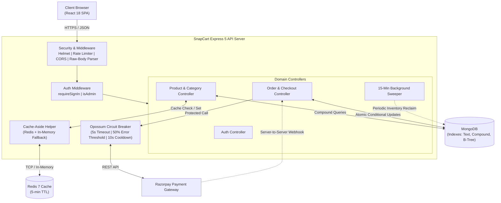
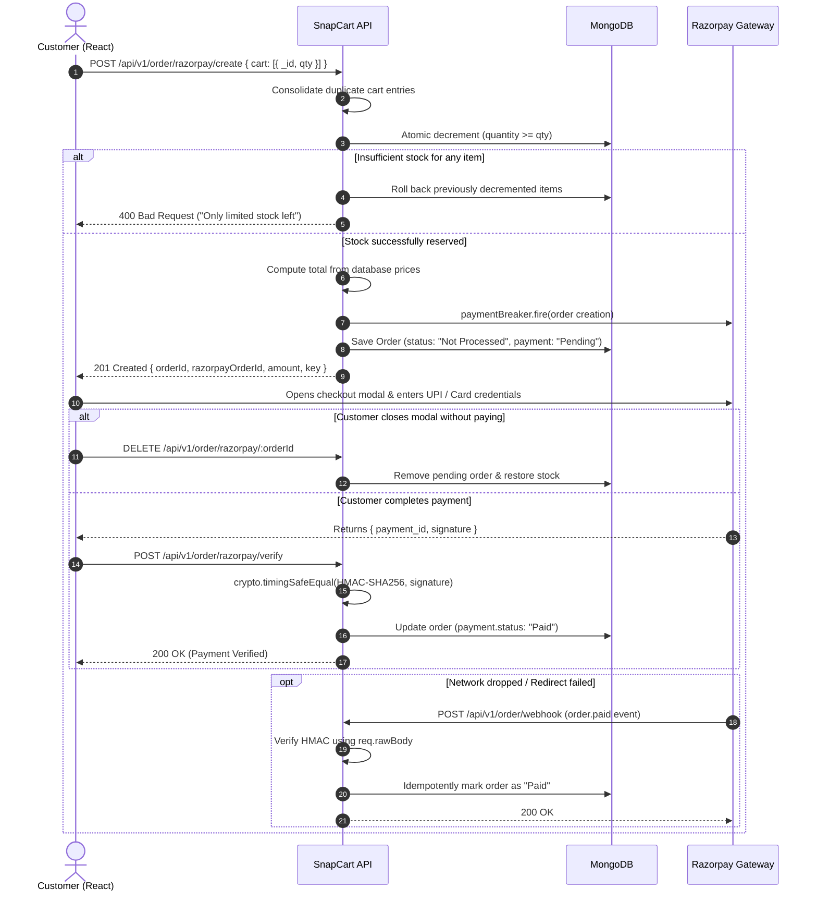

# SnapCart

[](https://github.com/akshit-max/SnapCart-Ecommerce-APP/actions/workflows/ci.yml)


SnapCart is a full-stack e-commerce web application built on the MERN stack (MongoDB, Express 5, React 18, Node.js). It provides a complete online shopping workflow with customer ordering, Razorpay and Cash-on-Delivery payment handling, inventory reservation, order cancellation with automated refunds, and an administrative management dashboard.

The application emphasizes core backend engineering patterns: atomic inventory updates to prevent overselling, circuit breaker protection around third-party payment gateways, Redis cache-aside with write-through invalidation, cryptographic webhook signature verification, and periodic reconciliation of abandoned checkouts.

---

## Table of Contents

- [Overview](#overview)
- [Key Features](#key-features)
- [Tech Stack](#tech-stack)
- [System Architecture](#system-architecture)
- [Core Engineering Decisions](#core-engineering-decisions)
- [Checkout & Payment Workflow](#checkout--payment-workflow)
- [Project Structure](#project-structure)
- [Prerequisites & Installation](#prerequisites--installation)
- [Environment Variables](#environment-variables)
- [Local Development](#local-development)
- [Running Automated Tests](#running-automated-tests)
- [Docker Setup](#docker-setup)
- [Production Build](#production-build)
- [API Reference](#api-reference)
- [Security Considerations](#security-considerations)
- [Current Limitations](#current-limitations)
- [Future Improvements](#future-improvements)
- [Author & License](#author--license)

---

## Overview

In e-commerce platforms, critical failures typically stem from concurrency and external dependencies:
1. **Overselling**: Multiple buyers competing for limited stock simultaneously.
2. **Third-Party Outages**: Sluggish payment gateway responses exhausting server thread pools.
3. **Dropped Sessions**: Customers closing browser tabs mid-payment, stranding reserved inventory indefinitely.
4. **Data Desynchronization**: Payment confirmation failures when client-side redirects fail.

SnapCart resolves these challenges within a clean, maintainable Modular Monolith using database-level atomic operations, fault-tolerance patterns, and server-to-server webhook reconciliation.

---

## Key Features

### Customer Experience
- **Catalog & Discovery**: Multi-parameter catalog filtering (category multi-select, price range, sorting by price or arrival date) and server-side pagination (6 items per page).
- **Search**: Full-text tokenized search backed by MongoDB text indexes, with automatic regex fallback for partial-word matching.
- **Cart Management**: Client-side cart state with quantity adjustments, persisted in `localStorage` across page reloads.
- **Checkout Flexibility**: Dual payment options—online payments via Razorpay (UPI, Credit/Debit cards, Netbanking) and Cash on Delivery (COD).
- **Order Lifecycle & Self-Cancellation**: Order history tracking (`Not Processed` &rarr; `Processing` &rarr; `Shipped` &rarr; `Delivered`). Users can cancel unfulfilled orders, triggering automated payment refunds.
- **User Profile**: Profile and delivery address management, along with security-question-based password reset.

### Administrative Controls
- **Metrics Dashboard**: Summary metrics for total revenue, aggregate orders, catalog count, user registrations, and automated low-stock warnings ($\le 5$ units).
- **Product Management**: Full CRUD capabilities for products, supporting multipart image uploads and category mapping.
- **Category Governance**: Category creation and updates, with safety constraints blocking deletion of categories containing active products.
- **Order Management**: Status progression controls (`Processing`, `Shipped`, `Delivered`, `Cancelled`) with automated inventory and refund handling on administrative cancellation.

### Backend Reliability
- **Atomic Stock Reservation**: Enforces conditional inventory decrements (`$gte`) to eliminate overselling under concurrent load.
- **Fault-Tolerant Payments**: Opossum circuit breaker wraps payment gateway calls, failing fast with graceful Cash-on-Delivery fallback during gateway degradation.
- **Inventory Sweeper**: Background sweeper runs every 10 minutes to release stranded stock from abandoned checkouts ($>15$ minutes) without deleting financial audit records.
- **Redis Cache-Aside**: Read-heavy catalog queries are cached in Redis with write-through cache purging on product and category updates, plus an in-memory fallback.
- **Webhook Reconciliation**: Server-to-server Razorpay webhooks process payments asynchronously using raw-byte HMAC-SHA256 signature validation.

---

## Tech Stack

| Domain | Technology | Purpose |
| :--- | :--- | :--- |
| **Frontend** | React 18, React Router 7 | Single Page Application with client-side routing |
| | Context API | Global authentication and cart state management |
| | Axios | HTTP client with automatic auth header injection |
| | Bootstrap 5, Ant Design | Responsive layout, UI controls, and toast notifications |
| **Backend** | Node.js (ES Modules), Express 5 | RESTful API server and static asset serving |
| | Mongoose 8 | Object Data Modeling with compound and text indexes |
| | Opossum 10 | Circuit Breaker pattern for external payment gateway calls |
| | JSON Web Tokens (JWT) | Stateless user authentication (7-day validity) |
| | bcrypt | Salted hashing for passwords and security answers (10 rounds) |
| | express-rate-limit, helmet | Ingress rate limiting and HTTP security headers |
| | Nodemailer | SMTP email transport for the contact form |
| **Database** | MongoDB Atlas / Local MongoDB 7 | Primary document database |
| **Caching** | Redis 7 / ioredis | Cache-aside catalog storage with in-memory Map fallback |
| **Payments** | Razorpay Node SDK | Order generation, HMAC validation, and automated refunds |
| **Testing** | Node.js Native Test Runner (`node:test`) | Fast, zero-dependency test runner |
| | Supertest | End-to-end HTTP endpoint assertions |
| | mongodb-memory-server | Ephemeral in-memory database isolation for tests |
| **DevOps** | Docker, Docker Compose | Containerized multi-service deployment |
| | GitHub Actions | Automated CI pipeline testing backend and building frontend on push |

---

## System Architecture

SnapCart follows a **Modular Monolith** structure. Application code is organized into decoupled domains (`auth`, `product`, `category`, `order`, `contact`), communicating through direct in-process calls to avoid network serialization overhead while maintaining clean domain boundaries.



---

## Core Engineering Decisions

### 1. Server-Side Price Calculation & Tamper Prevention
- **Decision**: The client sends only an array of `[{ _id, qty }]` during checkout.
- **Rationale**: Client-submitted totals or unit prices can be easily modified in browser developer tools or HTTP proxies. SnapCart queries MongoDB directly for the actual product price during order creation, computing the total amount on the server.

### 2. Concurrency-Safe Atomic Stock Reservation
- **Decision**: Stock is reserved before initiating payment using a single atomic conditional query:
  ```javascript
  const product = await productModel.findOneAndUpdate(
    { _id: productId, quantity: { $gte: qty } },
    { $inc: { quantity: -qty } },
    { new: true }
  );
  ```
- **Rationale**: Traditional "read-then-write" checks create race conditions during simultaneous purchases of the last item. MongoDB document-level write locking guarantees that exactly one decrement succeeds; subsequent requests find insufficient quantity and fail without negative stock. If any line item in a multi-item cart fails, previously reserved items are rolled back immediately.

### 3. Order Cancellation Concurrency Lock & Idempotent Stock Restoration
- **Decision**: Order cancellation uses an atomic timestamp lock (`cancellingAt`) with a 60-second recovery timeout and an explicit `stockRestored` boolean seal.
- **Rationale**: If a customer clicks "Cancel" twice in rapid succession or two requests race, only one request transitions `cancellingAt`. Once inventory is returned, `stockRestored` is flipped to `true`. Even if network drops occur or cancellation is retried, stock can never be restored twice.
- **Uncertain Gateway Responses**: If a previous cancellation attempt refunded the customer on Razorpay but the server timed out before recording it, subsequent cancellation attempts detect Razorpay's `"already refunded"` response and complete the cancellation smoothly rather than getting stuck.

### 4. Raw-Body Webhook Verification & Late-Payment Recovery
- **Decision**: The HMAC-SHA256 signature is verified against the raw request buffer (`req.rawBody`) captured by `express.json({ verify: ... })`.
- **Rationale**: Standard JSON parsers re-order keys and strip formatting, creating mismatches against the exact byte sequence hashed by the payment gateway.
- **Late Payments on Expired Orders**: When an order expires ($>15$ minutes) and its stock is returned by the sweeper, the record is marked `status: "Cancelled"`, `payment.status: "Expired"` instead of being hard-deleted. If the customer's bank completes the payment late, the webhook handler detects the expired state, automatically issues a refund through `getRazorpay().payments.refund()`, and records the refund ID.

### 5. Resilient Redis Cache-Aside with In-Memory Fallback
- **Decision**: Product catalog queries are cached in Redis for 300 seconds. Mutations (`create`, `update`, `delete` on products or categories) trigger pattern-based cache purges (`clearCachePattern("product")`).
- **Rationale**: The catalog is read-heavy. To prevent single-point-of-failure issues, the caching helper automatically switches to a self-expiring in-memory `Map` if Redis is offline or unconfigured, ensuring local development and production never crash due to cache connectivity problems.

### 6. Circuit Breaker on External Payment Calls
- **Decision**: External calls to create Razorpay orders are wrapped in an Opossum circuit breaker (5-second timeout, 50% error threshold over a 10-second rolling window).
- **Rationale**: If the external payment provider encounters latency or an outage, incoming checkout calls can hang and exhaust the Node.js event loop. The circuit breaker trips `OPEN`, fails fast, and instructs the user to complete checkout using Cash on Delivery. The live circuit status is exposed for monitoring at `GET /api/v1/order/circuit-status`.

---

## Checkout & Payment Workflow



---

## Project Structure

```
SnapCart/
├── backend/
│   ├── config/
│   │   └── db.js                       # MongoDB Mongoose connection
│   ├── controllers/
│   │   ├── authController.js           # Registration, login, password reset, profile
│   │   ├── categoryController.js       # Category CRUD & cache invalidation
│   │   ├── contactController.js        # Contact email dispatch with HTML escaping
│   │   ├── orderController.js          # Checkout, circuit breaker, sweeper, webhooks
│   │   └── productController.js        # Product CRUD, filters, pagination, search
│   ├── helpers/
│   │   ├── authHelper.js               # bcrypt hashing & public user sanitizer
│   │   └── cacheHelper.js              # Redis cache-aside with in-memory fallback
│   ├── middlewares/
│   │   └── authMiddleware.js           # requireSignIn (JWT) & isAdmin authorization
│   ├── models/
│   │   ├── categoryModel.js            # Category schema with unique slug index
│   │   ├── orderModel.js               # Order schema with concurrency & status indexes
│   │   ├── productModel.js             # Product schema with compound & text indexes
│   │   └── userModel.js                # User schema with hashed credentials
│   ├── routes/
│   │   ├── authRoutes.js
│   │   ├── categoryRoutes.js
│   │   ├── contactRoutes.js
│   │   ├── orderRoutes.js
│   │   └── productRoutes.js
│   ├── tests/
│   │   ├── auth.test.js                # Auth API test suite (6 tests)
│   │   ├── category.test.js            # Category API test suite (3 tests)
│   │   ├── order.test.js               # Orders, concurrency & webhook tests (14 tests)
│   │   ├── product.test.js             # Catalog, search & cache tests (5 tests)
│   │   └── setup.js                    # In-memory MongoDB lifecycle harness
│   ├── app.js                          # Express app configuration & middleware
│   ├── Dockerfile                      # Backend Node.js 20 Alpine container definition
│   ├── package.json
│   └── server.js                       # Server entrypoint & background sweeper timer
├── frontend/
│   ├── public/
│   ├── src/
│   │   ├── components/                 # Reusable Layout, Forms, and Route Guards
│   │   ├── context/                    # Auth, Cart, and Search React Context providers
│   │   ├── hooks/                      # Custom hooks (e.g., useCategory)
│   │   ├── pages/                      # Customer and Admin view components
│   │   ├── utils/                      # Currency formatting and Razorpay loader
│   │   ├── App.js                      # React Router configuration
│   │   └── index.js
│   ├── Dockerfile                      # Multi-stage build with Nginx web server
│   └── package.json
├── .github/workflows/
│   └── ci.yml                          # GitHub Actions CI workflow
├── docker-compose.yml                  # Full-stack container orchestration
├── package.json                        # Root workspace task runner scripts
└── README.md
```

---

## Prerequisites & Installation

### Prerequisites
- **Node.js**: Version 20.x or newer
- **npm**: Version 9.x or newer
- **MongoDB**: MongoDB Atlas connection string or local MongoDB instance
- **Razorpay Account** *(Optional)*: Test API keys from [Razorpay Dashboard](https://dashboard.razorpay.com). Cash on Delivery remains fully functional without keys.
- **Redis** *(Optional)*: Local Redis instance or container. The application falls back to an in-memory store if omitted.

### Installation

1. Clone the repository:
   ```bash
   git clone https://github.com/akshit-max/SnapCart-Ecommerce-APP.git
   cd SnapCart-Ecommerce-APP
   ```

2. Install root and workspace dependencies:
   ```bash
   npm install --prefix backend
   npm install --prefix frontend
   npm install
   ```

---

## Environment Variables

Create a `.env` file in the `backend/` directory based on [`backend/.env.example`](backend/.env.example):

```ini
PORT=8080
NODE_ENV=development
MONGO_URL=your_mongodb_connection_string
JWT_SECRET=your_jwt_secret_key_min_32_chars

# Frontend URL (required if frontend runs on a separate origin)
CLIENT_URL=http://localhost:3000

# Razorpay Test Credentials (Optional for COD)
RAZORPAY_KEY_ID=rzp_test_your_key_id
RAZORPAY_KEY_SECRET=your_razorpay_secret
RAZORPAY_WEBHOOK_SECRET=your_optional_webhook_secret

# Redis Caching (Optional - falls back to in-memory store if omitted)
REDIS_URL=redis://localhost:6379

# Contact Form Email Dispatch (Optional)
EMAIL_USER=your_email@gmail.com
EMAIL_PASS=your_gmail_app_password
```

> **Security Note**: Never commit actual `.env` files. Both `backend/.env` and `frontend/.env` are explicitly ignored by `.gitignore`.

---

## Local Development

Start both the backend server and React development client concurrently from the project root:

```bash
npm run dev
```

- **Frontend Client**: http://localhost:3000
- **Backend API**: http://localhost:8080
- **Health Check**: http://localhost:8080/api/v1/health

### Individual Service Commands:
- Run backend only: `npm run server` or `npm run backend`
- Run frontend only: `npm run frontend`

### Creating an Admin User:
1. Register a standard user account through the web interface.
2. In MongoDB, update the user document and set `role: 1`.
3. Log out and log back in to access the `/dashboard/admin` routes.

---

## Running Automated Tests

SnapCart includes an automated test suite executed with Node's native test runner against an isolated in-memory MongoDB server (`mongodb-memory-server`). Tests execute without touching real databases or requiring external network connectivity.

Execute the test suite from the root directory:

```bash
npm test
```

### Actual Test Suite Results:
```
▶ Auth API (6 tests)
  ✔ registers a user without sending back the password
  ✔ rejects missing fields and duplicate emails
  ✔ logs in with the right password and returns a token
  ✔ gives the same error for a wrong password and an unknown email
  ✔ resets the password with the security answer (case doesn't matter)
  ✔ protects user and admin routes

▶ Category API (3 tests)
  ✔ creates a new category and slugifies the name
  ✔ rejects duplicate category names
  ✔ blocks deleting a category when products are still assigned to it

▶ Order API (14 tests)
  ✔ uses the price from the database, not from the client
  ✔ does not oversell and puts back stock when one item fails
  ✔ restores stock when the user cancels
  ✔ accepts a valid razorpay signature and rejects a fake one
  ✔ lets only admins update order status
  ✔ cleans up abandoned pending orders and restores reserved stock
  ✔ processes razorpay webhook event and marks order paid
  ✔ checks system health status endpoint
  ✔ checks payment circuit breaker status
  ✔ prevents double stock restoration when two cancel requests arrive concurrently
  ✔ consolidates duplicate product entries in the cart into a single stock decrement
  ✔ handles duplicate webhook delivery idempotently without errors
  ✔ prevents overselling when two users concurrently purchase the last available item
  ✔ safely handles duplicate late-payment webhook for expired order without double refund

▶ Product API (5 tests)
  ✔ filters by price, sorts and paginates the product list
  ✔ handles regex characters in search safely
  ✔ only lets admins delete products
  ✔ returns 404 for a product that doesn't exist
  ✔ invalidates the catalog cache when an admin deletes a product

ℹ tests 28 | suites 4 | pass 28 | fail 0 | cancelled 0 | duration_ms ~5100ms
```

---

## Docker Setup

SnapCart includes multi-stage Docker configurations to orchestrate the entire platform locally with Docker Compose:

```bash
docker-compose up --build
```

### Service Map:
- **Backend API**: Port `8080` (Node 20 Alpine)
- **Frontend App**: Port `3000` (Nginx serving optimized production React build)
- **MongoDB**: Port `27017` (MongoDB 7 Jammy)
- **Redis Cache**: Port `6379` (Redis 7 Alpine)

To stop the containers and clean up volumes:
```bash
docker-compose down -v
```

---

## Production Build

To build the optimized client bundle and serve it through Express:

```bash
npm run build
NODE_ENV=production npm start
```

The production React bundle is compiled into `frontend/build/` (~144 kB gzipped) and statically hosted by Express, with fallback routing supporting React Router refreshes.

---

## API Reference

Base URL prefix: `/api/v1`. Protected routes require a valid JWT token in the `Authorization` header (`Bearer <token>` or raw token).

### Authentication & User Management
| Method | Endpoint | Access | Description |
| :--- | :--- | :--- | :--- |
| `POST` | `/auth/register` | Public | Register a new user account (rate-limited) |
| `POST` | `/auth/login` | Public | Authenticate user and receive a JWT token (rate-limited) |
| `POST` | `/auth/forgot-password` | Public | Reset password using verified security answer |
| `PUT` | `/auth/profile` | User | Update customer name, password, address, or phone |
| `GET` | `/auth/user-auth` | User | Verify customer authentication status |
| `GET` | `/auth/admin-auth` | Admin | Verify administrator privileges |
| `GET` | `/auth/all-users` | Admin | Retrieve user directory (passwords/answers excluded) |

### Products & Catalog
| Method | Endpoint | Access | Description |
| :--- | :--- | :--- | :--- |
| `GET` | `/product/product-list` | Public | Filtered, sorted, and paginated product list (cached) |
| `GET` | `/product/get-product` | Public | Complete product list for admin table |
| `GET` | `/product/get-product/:slug` | Public | Fetch product details by slug |
| `GET` | `/product/product-photo/:pid` | Public | Stream product image buffer (HTTP 86400s cache) |
| `GET` | `/product/search/:keyword` | Public | Full-text tokenized search with regex fallback |
| `GET` | `/product/related-product/:pid/:cid` | Public | Fetch related products in the same category |
| `POST` | `/product/create-product` | Admin | Create product with image upload (multipart/form-data) |
| `PUT` | `/product/update-product/:pid` | Admin | Update product details and photo |
| `DELETE`| `/product/delete-product/:pid` | Admin | Delete product and invalidate catalog cache |

### Categories
| Method | Endpoint | Access | Description |
| :--- | :--- | :--- | :--- |
| `GET` | `/category/get-category` | Public | List all categories in alphabetical order |
| `GET` | `/category/single-category/:slug` | Public | Fetch category by slug |
| `POST` | `/category/create-category` | Admin | Create new category with unique slug |
| `PUT` | `/category/update-category/:id` | Admin | Rename category and refresh slug |
| `DELETE`| `/category/delete-category/:id` | Admin | Delete empty category (blocked if products exist) |

### Checkout & Orders
| Method | Endpoint | Access | Description |
| :--- | :--- | :--- | :--- |
| `POST` | `/order/cod` | User | Place Cash on Delivery order with atomic stock reservation |
| `POST` | `/order/razorpay/create` | User | Create Razorpay order (Circuit Breaker protected) |
| `POST` | `/order/razorpay/verify` | User | Verify HMAC signature and confirm payment |
| `POST` | `/order/webhook` | Public | Asynchronous server-to-server webhook reconciliation |
| `GET` | `/order/circuit-status` | Public | Live Opossum payment circuit breaker health status |
| `DELETE`| `/order/razorpay/:orderId` | User | Dismiss unpaid checkout session and release reserved stock |
| `GET` | `/order/my-orders` | User | Customer order history sorted by creation date |
| `PUT` | `/order/cancel/:orderId` | User | Cancel unfulfilled order (triggers automated refund if paid) |
| `GET` | `/order/all-orders` | Admin | Administrative order listing with buyer population |
| `PUT` | `/order/status/:orderId` | Admin | Transition order status (`Shipped`, `Delivered`, etc.) |
| `GET` | `/order/stats` | Admin | Revenue, counts, and low-stock product metrics |

### System & Health
| Method | Endpoint | Access | Description |
| :--- | :--- | :--- | :--- |
| `GET` | `/health` | Public | Uptime, timestamp, and MongoDB connectivity status |
| `POST` | `/contact/send` | Public | Send customer inquiry email (HTML-sanitized & rate-limited) |

---

## Security Considerations

- **Credential Hashing**: Passwords and security answers are hashed using `bcrypt` (10 salt rounds). Hashed fields are stripped from all API outputs via projection and the `publicUser` sanitizer.
- **Timing-Safe Equality**: Signatures for payment verification and webhooks are compared using `crypto.timingSafeEqual` after validating input lengths, preventing timing side-channel attacks.
- **Input Sanitization**: User input destined for MongoDB regex queries is sanitized via character escaping. Contact form inputs are HTML-escaped before insertion into email templates.
- **Rate Limiting**: Authentication endpoints (`/login`, `/register`, `/forgot-password`) and contact forms are protected by `express-rate-limit` (20 requests per 15-minute window).
- **HTTP Hardening**: `helmet` sets security headers. CORS is restricted to `CLIENT_URL` in production environments.
- **Stateless Authorization**: JWT authentication eliminates server-side session stores, validated on both client routes and server endpoints.

---

## Current Limitations

- **Image Storage in MongoDB**: Product photos are currently stored as BSON buffers in MongoDB documents ($\le 1$ MB). While images are excluded from catalog queries (`.select("-photo")`) to maintain small payloads, high-scale production systems typically offload binary assets to dedicated object storage (AWS S3, Cloudinary).
- **Single-Region Scheduling**: The 10-minute abandoned cart sweeper uses an in-process Node.js interval (`setInterval`). In multi-instance cluster deployments, an external scheduler or distributed cron would coordinate execution.

---

## Future Improvements

- Transition binary image storage from MongoDB BSON buffers to AWS S3 or Cloudinary.
- Implement user reviews, star ratings, and discount coupon codes.
- Add automated email notifications for order confirmation and dispatch events.
- Implement refresh tokens stored in `httpOnly` secure cookies.
- Add end-to-end integration tests using Playwright.

---

## Author & License

- **Author**: Akshit Bhandula
- **GitHub**: [@akshit-max](https://github.com/akshit-max)
- **Repository**: [SnapCart-Ecommerce-APP](https://github.com/akshit-max/SnapCart-Ecommerce-APP)
- **License**: Licensed under the [MIT License](LICENSE).
