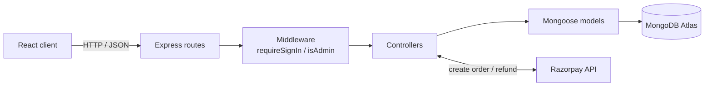
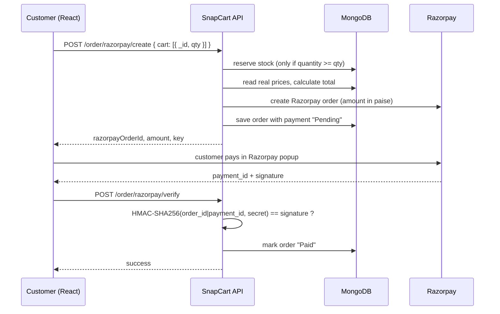

# SnapCart

[](https://github.com/akshit-max/SnapCart-Ecommerce-APP/actions/workflows/ci.yml)


SnapCart is a full stack e-commerce web app built with the **MERN stack** (MongoDB, Express, React, Node.js).
Customers can browse and filter products, manage a cart, pay online with **Razorpay** or choose cash on delivery, and track their orders.
Admins get a dashboard to manage products, categories, orders and users.

---

## Table of Contents

- [Features](#features)
- [Tech Stack](#tech-stack)
- [Architecture](#architecture)
- [How Checkout Works](#how-checkout-works)
- [Project Structure](#project-structure)
- [Getting Started](#getting-started)
- [Environment Variables](#environment-variables)
- [Running Tests](#running-tests)
- [API Reference](#api-reference)
- [Security](#security)
- [Design Decisions](#design-decisions)
- [Future Improvements](#future-improvements)

---

## Features

### Customer
- Browse products with **category and price filters, sorting and pagination**, all handled on the server
- Product search, product details page and similar product suggestions
- Cart with quantity controls, saved in the browser so it survives a refresh
- Checkout with **Razorpay** (UPI, cards, netbanking) or **Cash on Delivery**
- Order history with status tracking (Not Processed → Processing → Shipped → Delivered)
- Cancel an order before it is processed. Paid orders are **refunded automatically** through Razorpay
- Profile and delivery address update, password reset using a security question

### Admin
- Dashboard with total revenue, orders, products, users and **low stock alerts**
- Create, edit and delete products with image upload
- Create, rename and delete categories (a category with products in it can't be deleted)
- View all orders, filter them by status and update their status
- View all registered users

### General
- Stock is checked and reserved on the server, so products can't be oversold
- Protected routes for logged in users and admins (checked on both client and server)
- Responsive layout for mobile, tablet and desktop
- Dashboard and cart pages are lazy loaded to keep the first page load small

---

## Tech Stack

| Layer      | Technology |
| ---------- | ---------- |
| Frontend   | React 18, React Router 7, Context API, Axios, Bootstrap 5, Ant Design |
| Backend    | Node.js, Express 5 |
| Database   | MongoDB Atlas with Mongoose |
| Payments   | Razorpay (orders API, signature verification, refunds) |
| Auth       | JSON Web Tokens, bcrypt |
| Security   | helmet, express-rate-limit, CORS |
| Email      | Nodemailer (contact form) |
| Testing    | Node test runner, Supertest, mongodb-memory-server |
| CI         | GitHub Actions (runs tests and builds the client on every push) |

---

## Architecture

The backend follows the **MVC pattern**. Routes only map URLs to controllers, controllers hold the business logic,
and models define the data. React is the view layer and talks to the API over JSON.



**Data models**

| Model    | Main fields |
| -------- | ----------- |
| User     | name, email, password (hashed), phone, address, answer (hashed), role (0 = user, 1 = admin) |
| Category | name, slug |
| Product  | name, slug, description, price, quantity (stock), category, photo, shipping |
| Order    | items (product, name, price, qty), total, payment (method, status, razorpay ids), buyer, address, status |

---

## How Checkout Works

The client never decides the price. It only sends product ids and quantities.



- If the customer closes the popup, the pending order is removed and the stock is returned.
- If any item in the cart is out of stock, the items already reserved are put back before returning an error.
- Each order stores a **copy of the product name and price**, so editing or deleting a product later doesn't change old orders.

---

## Project Structure

```
SnapCart/
├── app.js                  # express app: middleware + routes (imported by tests)
├── server.js               # connects to MongoDB and starts the server
├── config/
│   └── db.js
├── controllers/
│   ├── authController.js       # register, login, reset password, profile, users
│   ├── categoryController.js
│   ├── productController.js    # CRUD, filters + pagination, search, photos
│   ├── orderController.js      # COD, Razorpay, cancel + refund, status, stats
│   └── contactController.js
├── middlewares/
│   └── authMiddleware.js       # requireSignIn, isAdmin
├── models/
│   ├── userModel.js
│   ├── categoryModel.js
│   ├── productModel.js
│   └── orderModel.js
├── routes/
│   ├── authRoutes.js
│   ├── categoryRoutes.js
│   ├── productRoutes.js
│   ├── orderRoutes.js
│   └── contactRoutes.js
├── helpers/
│   └── authHelper.js           # bcrypt helpers, safe user object
├── tests/                      # API tests
├── .github/workflows/ci.yml
└── client/                     # React app
    └── src/
        ├── components/
        │   ├── Layout/         # Header, Footer, Layout, DashboardLayout, menus
        │   ├── Form/           # ProductForm, CategoryForm, SearchInput
        │   ├── Routes/         # PrivateRoute (user + admin)
        │   ├── ProductCard.js
        │   └── OrderCard.js
        ├── context/            # auth and cart state
        ├── hooks/              # useCategory
        ├── pages/              # shop pages, Auth/, user/, Admin/
        └── utils/              # price/date formatting, Razorpay loader
```

---

## Getting Started

### Prerequisites

- Node.js 20 or newer
- A MongoDB Atlas cluster (the free tier works)
- A Razorpay account in **test mode** (no KYC needed for test keys)

### Installation

```bash
git clone https://github.com/akshit-max/SnapCart-Ecommerce-APP.git
cd SnapCart-Ecommerce-APP

npm install               # backend
npm install --prefix client
```

Create a `.env` file in the root folder (see [Environment Variables](#environment-variables)), then run:

```bash
npm run dev
```

- Frontend: http://localhost:3000
- API: http://localhost:8080

### Making an admin

Register a normal account, then set `role` to `1` for that user in MongoDB.

### Test payments

In Razorpay test mode no real money is charged. Use the UPI ID **`success@razorpay`**
to simulate a successful payment, or `failure@razorpay` for a failed one.

### Production build

The Express server also serves the React build:

```bash
npm run build
NODE_ENV=production npm start
```

### Available scripts

| Command          | What it does |
| ---------------- | ------------ |
| `npm run dev`    | Runs the backend (nodemon) and the React dev server together |
| `npm run server` | Backend only |
| `npm run client` | Frontend only |
| `npm test`       | Runs the API tests |
| `npm run build`  | Installs client packages and builds the React app |
| `npm start`      | Starts the server (used in production) |

---

## Environment Variables

| Variable              | Description |
| --------------------- | ----------- |
| `PORT`                | API port (default 8080) |
| `NODE_ENV`            | `development` or `production` |
| `MONGO_URL`           | MongoDB connection string |
| `JWT_SECRET`          | Any long random string used to sign tokens |
| `CLIENT_URL`          | Frontend URL, only needed if the client is hosted on a different domain |
| `RAZORPAY_KEY_ID`     | Razorpay key id (Dashboard → Settings → API Keys) |
| `RAZORPAY_KEY_SECRET` | Razorpay key secret |
| `EMAIL_USER`          | Gmail address for the contact form |
| `EMAIL_PASS`          | Gmail app password |

A template is available in [`.env.example`](.env.example). The app still runs without Razorpay keys, only Cash on Delivery will be available.

---

## Running Tests

```bash
npm test
```

The tests start an **in-memory MongoDB**, so they don't need a database connection and never touch real data.
They cover:

- Registration, login, password reset and that passwords are never returned
- Same error message for wrong password and unknown email
- User and admin route protection (401 / 403)
- Product filters, sorting, pagination and safe search
- Orders using the database price even if the client sends a different one
- Stock rollback when one item in the cart is out of stock
- Stock restore on cancel
- Razorpay signature verification (valid and fake signatures)
- Order status updates (admin only, invalid statuses rejected)

The same tests run on every push through GitHub Actions, along with a production build of the client.

---

## API Reference

Base URL: `/api/v1`. Protected routes expect the JWT in the `Authorization` header.

### Auth

| Method | Endpoint                | Access | Description |
| ------ | ----------------------- | ------ | ----------- |
| POST   | `/auth/register`        | Public | Create an account |
| POST   | `/auth/login`           | Public | Login and receive a token |
| POST   | `/auth/forgot-password` | Public | Reset password with the security answer |
| PUT    | `/auth/profile`         | User   | Update name, phone, address or password |
| GET    | `/auth/user-auth`       | User   | Check if the token is valid |
| GET    | `/auth/admin-auth`      | Admin  | Check if the user is an admin |
| GET    | `/auth/all-users`       | Admin  | List all users |

### Products

| Method | Endpoint                               | Access | Description |
| ------ | -------------------------------------- | ------ | ----------- |
| GET    | `/product/product-list`                | Public | Paginated list. Query: `page`, `categories`, `min`, `max`, `sort` (`newest`, `price-asc`, `price-desc`) |
| GET    | `/product/get-product`                 | Public | All products (admin table) |
| GET    | `/product/get-product/:slug`           | Public | Single product |
| GET    | `/product/product-photo/:pid`          | Public | Product image |
| GET    | `/product/search/:keyword`             | Public | Search by name or description |
| GET    | `/product/related-product/:pid/:cid`   | Public | Similar products |
| GET    | `/product/product-category/:slug`      | Public | Products in a category |
| POST   | `/product/create-product`              | Admin  | Create product (multipart form) |
| PUT    | `/product/update-product/:pid`         | Admin  | Update product |
| DELETE | `/product/delete-product/:pid`         | Admin  | Delete product |

### Categories

| Method | Endpoint                         | Access | Description |
| ------ | -------------------------------- | ------ | ----------- |
| GET    | `/category/get-category`         | Public | All categories |
| GET    | `/category/single-category/:slug`| Public | Single category |
| POST   | `/category/create-category`      | Admin  | Create category |
| PUT    | `/category/update-category/:id`  | Admin  | Rename category |
| DELETE | `/category/delete-category/:id`  | Admin  | Delete an empty category |

### Orders

| Method | Endpoint                     | Access | Description |
| ------ | ---------------------------- | ------ | ----------- |
| POST   | `/order/cod`                 | User   | Place a cash on delivery order |
| POST   | `/order/razorpay/create`     | User   | Reserve stock and create a Razorpay order |
| POST   | `/order/razorpay/verify`     | User   | Verify the payment signature and mark the order paid |
| DELETE | `/order/razorpay/:orderId`   | User   | Remove an unpaid order when the popup is closed |
| GET    | `/order/my-orders`           | User   | Logged in user's orders |
| PUT    | `/order/cancel/:orderId`     | User   | Cancel an order that isn't processed yet (refunds if paid) |
| GET    | `/order/all-orders`          | Admin  | All orders |
| PUT    | `/order/status/:orderId`     | Admin  | Update order status |
| GET    | `/order/stats`               | Admin  | Dashboard numbers and low stock products |

### Contact

| Method | Endpoint         | Access | Description |
| ------ | ---------------- | ------ | ----------- |
| POST   | `/contact/send`  | Public | Send a message to the store's email |

---

## Security

- Passwords and security answers are hashed with **bcrypt**; API responses never include them
- **JWT** authentication with 7 day expiry; the client logs out automatically when a token expires
- Admin routes are checked on the server with the `isAdmin` middleware, not only hidden in the UI
- **Rate limiting** on login, register, password reset and the contact form
- **helmet** security headers and restricted CORS in production
- Prices and totals are always calculated on the server
- Razorpay payments are verified with an **HMAC-SHA256 signature** using a timing safe comparison
- Search input is escaped before it is used in a regex, and contact form input is escaped before it goes into an email
- Login returns the same message for a wrong email and a wrong password, so accounts can't be discovered

---

## Design Decisions

**Why reserve stock before payment?**
If stock was only checked after payment, two customers could pay for the last item and one would need a refund.
Reserving first with a conditional update (`quantity >= qty`) makes the check and the decrement a single atomic
operation in MongoDB. If the payment doesn't happen, the stock is returned.

**Why store name and price inside the order?**
Orders are a record of what was bought and for how much. Referencing only the product id would make old orders
change whenever a product is edited or deleted.

**Why one endpoint for filters, sorting and pagination?**
Doing all three on the server keeps the client simple and means "load more" keeps working while filters are applied.
It also avoids sending every product to the browser.

**Why split `app.js` and `server.js`?**
Tests import the Express app directly without opening a port or connecting to the real database.

---

## Future Improvements

- Razorpay webhooks, so a payment is confirmed even if the customer closes the browser right after paying
- Move product images to Cloudinary or S3 instead of storing them in MongoDB
- Product reviews and ratings, wishlist and coupon codes
- Email notifications for order confirmation and status changes
- Refresh tokens stored in httpOnly cookies
- Frontend tests with React Testing Library and end-to-end tests with Playwright

---

## Author

**Akshit Bhandula**
GitHub: [@akshit-max](https://github.com/akshit-max)

## License

This project is licensed under the MIT License.
